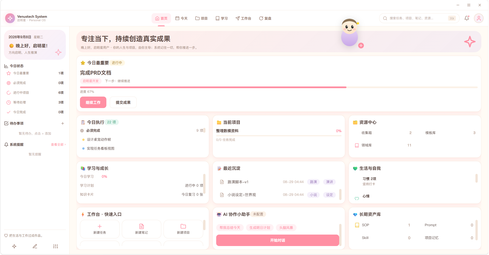

# 启明星系统（Venustech System）

> **方向启明，人生推演** —— 本地优先的个人工作台 / 个人操作系统（Personal OS）。
> 任务、项目、知识、成长、复盘、资产与 AI 第二分身，跑在你自己的电脑上。



*奶油糖果主题 · 首页主面板*

**版本** `0.7.0`（唯一事实来源：[VERSION](VERSION)）· **架构** [ARCHITECTURE.md](ARCHITECTURE.md)

---

## 这是什么

- **本地优先**：数据只存本机 SQLite（WAL）。无云端、无账号体系、无数据上传。
- **闭环工作台**：输入（收集箱/习惯/心情）→ 处理（任务/项目/学习）→ 输出（复盘/写作/SOP）→ 沉淀（资产库）→ 复用（模板/工作流）。
- **第二分身**：长期记忆 + 多模型切换 + 桌宠陪伴；未配置 AI Key 时全部功能降级为本地规则引擎，离线可用。
- **多端**：PC 浏览器 + Android（Capacitor）+ PWA；弱网写操作进离线队列，恢复后重放。

**技术栈**：FastAPI + SQLAlchemy 2 + SQLite + Alembic ｜ Vue 3 + TypeScript + Vite + Pinia + Element Plus ｜ Node 统一边缘服务 ｜ 四套主题（CSS 变量）。

---

## 30 秒看懂架构

```
浏览器 / 手机
   │  HTTP  {code,message,data}
   ▼
ops/server/server.js        静态资源 + /api 代理 + 访问令牌（唯一对外入口 :3000）
   ▼
backend/app/api/*.py        路由与校验（不写业务）
   ▼
backend/app/services/*.py   业务规则 / 状态机 / 事务编排
   ▼
backend/app/repositories/*  数据访问
   ▼
backend/app/models/*.py     SQLAlchemy → SQLite
```

一条铁律：**依赖单向** `api → services → repositories → models`，`core/` 只能被依赖。
完整推导（含一条请求的 15 跳、领域地图、新增模块清单）见 **[ARCHITECTURE.md](ARCHITECTURE.md)**。

---

## 快速开始

环境：Python 3.11+、Node 18+（可选 [uv](https://docs.astral.sh/uv/)）。

```bash
# 1) 首次安装依赖（只做一次；不会碰 git）
setup.bat

# 2) 开发启动：后端 127.0.0.1:8765 + 前端 http://localhost:5173
start-dev.bat

# 准备给别人的演示数据（独立库，不污染真实数据）
start-demo.bat

# 手机 / 局域网（后端只绑回环，唯一对外端口 3000，需要访问令牌）
start-mobile.bat
```

手动启动（等价）：

```bash
# 后端（必须用项目 venv，PATH 上的 python 通常缺依赖）
cd backend
.venv\Scripts\python.exe -m uvicorn app.main:app --host 127.0.0.1 --port 8765 --reload

# 前端
cd frontend && npm run dev

# 统一服务（生产/移动端；先 npm run build）
node ops/server/server.js        # → http://<本机IP>:3000
```

> 数据目录默认 `backend/data`，可用 `VENUSTECH_DATA_DIR` 覆盖（演示/分支隔离/测试都用它）。
> 配置项见 [backend/.env.example](backend/.env.example)，**AI API Key 不入环境变量**（按用户加密存库，在 App 设置页填）。

---

## 验证（提交前必过）

```bash
python scripts/check_all.py          # 13 项一键校验（架构/测试/冒烟/版本/文档链接/审计…）
python scripts/check_all.py --strict # CI 用：缺依赖=失败，杜绝"跳过即通过"
```

单项：

```bash
python scripts/audit_architecture.py       # 架构守护（分层/领域归属/根目录契约）
cd backend && python -m pytest tests -q    # 后端测试
cd frontend && npm run typecheck && npm test
```

CI：`.github/workflows/{backend,frontend,repo-guard}.yml`（Android 打包另有 `android-build.yml`）。

---

## 项目结构（顶层）

| 目录 | 职责 |
|---|---|
| `backend/` | FastAPI 后端：`api → services → repositories → models`，`core/` 基础设施，`bootstrap/` 组合根 |
| `frontend/` | Vue 3 前端（含 Capacitor Android 工程） |
| `ops/` | 运行时与运维：统一 Web 服务 `server/server.js`、推送辅助 |
| `scripts/` | 质量门禁与工程脚本（check_all / audit_* / check_versions） |
| `docs/` | 文档：架构 / 产品 / 指南 / 过程归档 / 设计素材（索引见 [docs/README.md](docs/README.md)） |
| `var/` | 运行期数据约定（gitignored） |
| `*.bat` | 仅 4 个用户启动器（setup / start-dev / start-demo / start-mobile） |

根目录契约由架构守护强制；每个目录的"能放什么/禁止什么"见 [ARCHITECTURE.md §6](ARCHITECTURE.md)。

---

## 文档

| 我想… | 看这里 |
|---|---|
| 搞懂整体架构、怎么加模块 | [ARCHITECTURE.md](ARCHITECTURE.md) |
| 找某类文档 | [docs/README.md](docs/README.md) |
| 开发规范 / 启动 / 分支 | [docs/guides/development.md](docs/guides/development.md) |
| 为什么这么设计 | [docs/architecture/ADR/](docs/architecture/ADR/) |
| 备份 / 恢复 | [docs/runbooks/backup.md](docs/runbooks/backup.md) |
| 参与开发 / 提交纪律 | [CONTRIBUTING.md](CONTRIBUTING.md) |
| 版本变化 | [CHANGELOG.md](CHANGELOG.md) |

---

## 安全与数据

- **本地优先**：数据在 `$VENUSTECH_DATA_DIR/app.db`；敏感字段 AES + HMAC 加密（`core/encryption.py`）。
- **唯一对外入口**：`ops/server/server.js` :3000 需 `X-API-Token`（回环来源豁免，PC 前端零配置）。
- **备份铁律**：`app.db` 与 `.encryption_key` 必须成对备份，否则加密字段不可恢复 → [backup.md](docs/runbooks/backup.md)。
- **已知风险**：当前仍有 P0 级安全/功能债务（令牌回环绕过、旧分支含真实库、备份导入 422）。
  **上线/外网暴露前必读** [ARCHITECTURE.md §10 架构债务](ARCHITECTURE.md)。

---

## 许可

个人项目，保留所有权利。仅供学习与个人使用。
