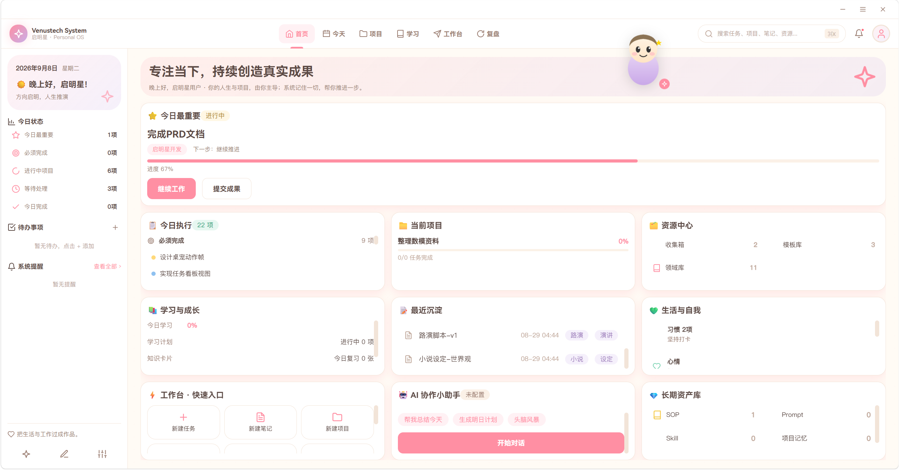

# 启明星系统（Venustech System）

> **方向启明，人生推演** —— 一个**本地优先的个人操作系统（Personal OS）**。
> 任务、项目、知识、成长、复盘、资产与 AI 第二分身，全部跑在你自己的电脑上：不登录、不上传、数据只落在本地 SQLite。

[](https://github.com/YanYuas/VenustechSystem/actions/workflows/backend.yml)
[](https://github.com/YanYuas/VenustechSystem/actions/workflows/frontend.yml)
[](https://github.com/YanYuas/VenustechSystem/actions/workflows/repo-guard.yml)
[](https://github.com/YanYuas/VenustechSystem/actions/workflows/windows-startup.yml)
[](LICENSE)
[](CHANGELOG.md)
[](https://github.com/YanYuas/VenustechSystem/actions/workflows/backend.yml)
[](https://github.com/YanYuas/VenustechSystem/actions/workflows/frontend.yml)



*奶油糖果主题 · 首页主面板（四套主题可切换，见下方[主题画廊](#主题画廊)）*

**技术栈**：FastAPI + SQLAlchemy 2 + SQLite（WAL）+ Alembic ｜ Vue 3 + TypeScript + **Vite 8**（Rolldown + oxc）+ Pinia + Element Plus ｜ Node 统一边缘服务 ｜ Capacitor（Android）/ PWA

---

## 30 秒看懂：为什么值得装在自己电脑上

市面上的效率工具把「任务 / 笔记 / 习惯 / 复盘 / 资产 / AI」拆成六个 App，数据散落在六家云上。启明星把它们做成**一个本地闭环**：

```
输入 ──► 处理 ──► 输出 ──► 沉淀 ──► 复用
收集箱    任务/项目    复盘/写作    资产库     模板/工作流
习惯/心情  学习/工作流   报告/SOP    SOP/Skill  自动化
```

- **本地优先**：单用户、无账号体系；数据只存本机 SQLite；核心功能完全离线可用（AI 资讯等联网能力为可选增强）。
- **一个闭环工作台**：从"随手记下"到"沉淀成可复用资产"，全程不换工具、不导出导入。
- **AI 是增强而非依赖**：填入 DeepSeek Key（OpenAI 兼容接口）即启用真实 AI 对话；完全不配 Key 也能用 —— 对话走 Mock 降级，其余功能全部本地可用。
- **诚实边界**：这是单人/小团队长期维护的本地应用，不是 SaaS、不是多租户、不是微服务。数据在你手里，代价是它不做账号体系与云同步（见[已知限制](#已知限制与后续方向)）。

四类典型场景：

| 你在做什么 | 在启明星里怎么用 |
|---|---|
| 每天被任务和项目追着跑 | 今日面板 + 任务状态机（含子任务/看板）+ 项目聚合空间 + 工作流中心（预设模板一键套用） |
| 信息散落、知识不沉淀 | Markdown 文档 + 文件夹 + 双向链接图谱 + 闪卡/学习计划 + 资源收集箱 + 模板 |
| 想长期看到自己的成长 | 习惯打卡 + 心情/日记 + 成长值与身份 + 每日/每周/每月复盘 |
| 需要一个懂自己的 AI | 第二分身多轮对话 + 长期记忆 + 灵感工作流；AI 自动化档位 L1–L5 可调；桌宠陪伴 |

---

## 功能亮点

按 8 个领域组织（机器可读定义见 [domains.json](docs/architecture/domains.json)，架构推导见 [ARCHITECTURE.md](ARCHITECTURE.md)）：

1. **任务与项目**（execution）：任务状态机、子任务与优先级、列表/看板双视图；项目空间聚合任务/文档/对话；工作流中心用预设模板一键生成标签与模板。
2. **知识与文档**（knowledge）：Markdown 编辑与文件夹层级、双向链接知识图谱、闪卡 + 学习计划（间隔重复）、资源收集箱、模板库、经验沉淀。
3. **成长与复盘**（growth）：习惯打卡、心情与日记、成长状态/经验值/身份体系，以及每日/每周/每月复盘（另支持项目复盘）。
4. **资产沉淀**（asset）：资产库、**加密保险箱**、SOP 与版本、Skill、Prompt、项目记忆 —— 把一次性产出变成可复用资产。
5. **AI 第二分身**（assistant）：多轮对话、DeepSeek（OpenAI 兼容接口）接入、长期记忆与灵感工作流、AI 自动化档位 L1–L5（设置页可调）；**未配 Key 时对话走 Mock 降级**，其余功能不缺席。
6. **桌宠陪伴**（companion）：桌宠/人形形态切换、多动作互动、自定义形象、TTS 语音（设置页可试听）—— 情感化的日常陪伴。
7. **多端与离线**（platform）：PC 浏览器 + Android（Capacitor APK）+ PWA；弱网写操作进**离线队列**，恢复后自动重放；单一对外入口 :3000 + 访问令牌。
8. **数据洞察与主题**（insight）：仪表盘与周期报告；四套主题（奶油糖果 / 国风雅集 / 深渊档案 / 史诗典藏）× 明暗模式，纯 CSS 变量实现。

---

## 主题画廊

四套完整主题，全部可直接在浏览器打开预览（纯静态 HTML）：

| 主题 | 风格 | 预览 |
|---|---|---|
| 奶油糖果 | 治愈软萌 · 薄荷绿 | [打开预览](docs/design/UI组件画廊-奶油糖果.html) |
| 国风雅集 | 中国古典 · 朱砂红 | [打开预览](docs/design/UI组件画廊-国风雅集.html) |
| 深渊档案 | 海洋神秘 · 磷火青 | [打开预览](docs/design/UI组件画廊-深渊档案.html) |
| 史诗典藏 | 金琥珀传说 · 史诗质感 | [打开预览](docs/design/UI组件画廊-史诗典藏.html) |

主题总览：[UI组件画廊.html](docs/design/UI组件画廊.html)（四套主题 × 组件全量展示）

---

## 快速开始

### Windows：4 个一键入口

根目录 `.bat` 是**薄转发壳**，真正实现只在 [ops/start.ps1](ops/start.ps1) 与 [ops/setup.ps1](ops/setup.ps1)（单一实现，D-11）。

| 命令 | 作用 | 端口 |
|---|---|---|
| `setup.bat` | 首次安装：Python venv + 后端依赖 + 前端 `npm ci`（只装依赖，不碰 git） | — |
| `start-dev.bat` | 开发模式：Vite HMR + uvicorn `--reload`，数据在 `var/data` | 5173 / 8765 |
| `start-demo.bat` | 演示模式：独立库 `var/demo`（缺库自动 seed），**不污染真实数据** | 5173 / 8765 |
| `start-mobile.bat` | 手机 / 局域网：统一服务对外，后端只绑回环，需访问令牌 | **3000** |

```bat
setup.bat              :: 首次安装（只做一次）
start-dev.bat          :: 写代码
start-demo.bat         :: 给人演示（独立演示库）
start-mobile.bat       :: 手机 / 局域网 / Tailscale 访问
```

**启动自检**：`start-dev.bat -Verify` —— 真启动 → 健康检查 → 自动停止，退出码 0/1；适合改完启动脚本或升级前排障。
**只预演不启动**：`ops\start.ps1 -Mode dev -WhatIf` 只打印将执行的命令与环境变量。
细节见 [启动与自检 runbook](docs/runbooks/startup.md)，子进程日志在 `var/logs/`。

### Linux / macOS：最小等价命令

```bash
# 1) 后端依赖（Python 3.11+；requirements-dev.txt 已包含 -r requirements.txt）
python3 -m venv backend/.venv
backend/.venv/bin/python -m pip install --upgrade pip
backend/.venv/bin/python -m pip install -r backend/requirements-dev.txt

# 2) 前端依赖（Node 24 LTS；Node 20 跑不了前端测试）
cd frontend && npm ci && cd ..

# 3) 启动（两个终端）
cd backend && .venv/bin/python -m uvicorn app.main:app --host 127.0.0.1 --port 8765 --reload
cd frontend && npm run dev                      # http://localhost:5173

# 4) 演示库 / 分支隔离：同一个 VENUSTECH_DATA_DIR
export VENUSTECH_DATA_DIR="$(pwd)/var/demo"     # 缺库时先跑 backend/.venv/bin/python backend/scripts/seed_demo.py

# 5) 生产 / 手机：构建后由统一入口托管
cd frontend && npm run build && cd .. && node ops/server/server.js   # http://<本机IP>:3000
```

### 端口与数据

| 端口 | 进程 | 绑定 | 说明 |
|---|---|---|---|
| `8765` | FastAPI / uvicorn | **127.0.0.1** | 后端 API，永远只绑回环 |
| `5173` | Vite dev server | localhost | 开发前端（生产走 3000） |
| `3000` | [ops/server/server.js](ops/server/server.js) | 0.0.0.0（可选） | 唯一对外入口：静态资源 + `/api` 代理 + 令牌鉴权 |

- 数据目录默认 `<仓库根>/var/data`（打包后走 `%APPDATA%/VenustechSystem`），可用 `VENUSTECH_DATA_DIR` 覆盖（演示/分支隔离/测试都用它）。
- `var/{data,demo,logs,backups,legacy}` 全部 gitignored；**仓库里永远不应该出现数据库、密钥、日志**。
- 配置项见 [backend/.env.example](backend/.env.example)；**AI API Key 不走环境变量**，按用户加密存库、在 App 设置页填写。

---

## 架构一图流

```
浏览器 / 手机
   │  HTTP  {code, message, data}
   ▼
ops/server/server.js        静态资源 + /api 代理 + 访问令牌（唯一对外入口 :3000）
   ▼
backend/app/api/*.py        路由与校验（不写业务）
   ▼
backend/app/services/*.py   业务规则 / 状态机 / 事务编排
   ▼
backend/app/repositories/*  数据访问
   ▼
backend/app/models/*.py     SQLAlchemy → SQLite（WAL）
```

**一条铁律**：依赖单向 `api → services → repositories → models`；`core/` 只能被依赖，不能向上依赖；只有 `app/main.py`、`app/bootstrap/`、`api/deps.py` 允许"知道所有层"。**违反即 CI 红**（AST 守护，不是靠自觉）。

8 个领域：平台底座 / 执行管理 / 个人知识 / 个人成长 / AI 交互 / 桌宠陪伴 / 资产沉淀 / 数据洞察。完整推导（一条请求的 15 跳、领域地图、新增模块步骤）见 **[ARCHITECTURE.md](ARCHITECTURE.md)**。

**3 条设计决策**：

1. **模块化单体，不做微服务**（[ADR-0001](docs/architecture/ADR/0001-layered-modular-monolith.md)）：单机单用户，拆服务只增加运维成本；收益来自边界收口，由 `domains.json` + AST 守护强制，而不是目录名。
2. **事务边界在 Service**（[D-04](ARCHITECTURE.md)）：Repository 只 `flush`、Service 控 `commit`、`get_db` 兜底 —— 多步操作要么全成要么全败，失败可回滚。
3. **测试与门禁先行**（[ADR-0003](docs/architecture/ADR/0003-architecture-as-code.md)）：覆盖率棘轮 + 16 项一键门禁 + 5 条 CI pipeline；项目教训是"**写了却跑不了的测试等于没有测试**"，所以任何守护必须同时进 `check_all.py` 与 CI。

---

## 质量与验证

| 维度 | 命令 | 现状 |
|---|---|---|
| 一键门禁 | `python scripts/check_all.py --strict` | **16 项全绿**（缺依赖 = 失败，杜绝假绿） |
| 后端测试 | `cd backend && python -m pytest tests -q` | **2071 passed** |
| 后端覆盖率 | `cd backend && python -m pytest tests -q --cov=app --cov-report=term-missing --cov-fail-under=99` | **99.82%**（阈值 99） |
| 后端 lint | `cd backend && python -m ruff check app tests` | 0（正确性规则 E4/E7/E9/F） |
| 前端单测 | `cd frontend && npm test` | **604 passed** |
| 前端覆盖率 | `cd frontend && npm run test:coverage` | lines **71.25%**（口径 v2；阈值 70/64/49/69 棘轮，说明见 [frontend.md §九](docs/guides/frontend.md)） |
| 前端质量 | `cd frontend && npm run lint && npm run typecheck && npm run format:check` | 0（ESLint 含 ADR-0007 分层边界） |
| 启动自检 | `start-dev.bat -Verify` | 真启动 → 健康检查 → 自动停止 |

**5 条 CI pipeline**（`.github/workflows/`，全绿）：

| Workflow | 守什么 |
|---|---|
| [backend-ci](.github/workflows/backend.yml) | Python 3.11：架构守护 → ruff → pytest → 覆盖率阈值 99% → 端到端冒烟 |
| [frontend-ci](.github/workflows/frontend.yml) | Node 24：ESLint / Prettier / vue-tsc / vitest + 覆盖率阈值 / 构建 |
| [repo-guard](.github/workflows/repo-guard.yml) | 版本一致性、日志格式、测试质量、交付物、工作区卫生、文档链接、敏感文件门禁、边缘服务单测 |
| [android-apk](.github/workflows/android-build.yml) | Capacitor 同步 + 构建 debug APK |
| [windows-startup](.github/workflows/windows-startup.yml) | Windows runner 真跑 `ops/start.ps1 -Mode dev -Verify` |

单项守护（架构 / 目录卫生 / 文档链接 / 版本一致…）见 [ARCHITECTURE.md](ARCHITECTURE.md) §9。

---

## 路线图与状态

**已完成 Phase 0–17**（详细记录见 [CHANGELOG.md](CHANGELOG.md)）：

| 阶段 | 主题 | 关键产出 |
|---|---|---|
| Phase 0 | 架构可见、可守、可查 | 架构总纲 + `domains.json` + AST 守护 + 债务基线 + CI + 文档 IA |
| Phase 1 | 修正确性 P0/P1 | 令牌绕过、备份导入、事务边界、迁移基线、前端契约、死代码 |
| Phase 2 | 收口领域边界 | Repository 收口（156 处直连 → 0）、sync 下沉、SettingsView 1701→291 行 |
| Phase 3 | 可持续交付 | 前端 `kernel/shared/features` 全量迁移、启动器单一实现、lint 进 CI |
| Phase 4 | 交付收尾 | 仓库重建彻底清除历史泄漏、CI 首跑全绿、数据物理迁移 `var/` |
| Phase 5 | 结构治理 | 工作区卫生守护、后端覆盖率 88.5%、`-Verify` 启动自检 |
| Phase 6 | 修测试发现的真 bug | IDOR / 500 / 日志后端混用 / SSE 鉴权；后端覆盖率 92% |
| Phase 7 | 日志统一 + 覆盖率棘轮 | D-22~D-28 修复；后端 96%、前端覆盖率阈值进 CI |
| Phase 8 | 启动脚本进 CI | D-29~D-35；新增 windows-startup workflow |
| Phase 9 | 生命周期测试 | D-36~D-38；覆盖率 artifact、前后端阈值对齐 |
| Phase 10 | 备份恢复安全 | D-39~D-45；子进程隔离的真实恢复测试 |
| Phase 11 | 数据安全 + 大组件测试 | D-46/47：备份原子替换 + 自动回滚；前端 lines 82.4% |
| Phase 12 | 事件总线修复 | D-48/49：异步 handler 不静默丢失；后端 98.33% |
| Phase 13 | 校验收尾 + 仓库治理 | D-50~D-54；Dependabot / PR 模板 / CODEOWNERS；后端 98.95% |
| Phase 14 | 依赖治理 + 定时器收尾 | D-55；7 个 Dependabot PR 合并；登记 D-56/D-57；**1965 / 98.94%**、**515 / 82.2%** |
| **Phase 15** | **发行治理（v1.0.0）** | 版本 0.7.0 → **1.0.0**、MIT License、Release Notes、发布流程、本展示页 |
| Phase 16 | SQLAlchemy 2.1 升级 | D-56 闭环（5 列显式 Float + SQLAlchemy 2.1.6/alembic 1.20.1）；后端 1995 / 99.41%、前端 569 / 84.77% |
| **Phase 17** | **P2 加密原子性 + v1.0.1** | D-58~D-65 修复（加密轮换回滚、时间线/导出 500、DocumentGraph 样式失效等）；后端 **2026 / 99.75%**、前端 **578 / 84.79%**；首发补丁 **v1.0.1** |
| **Phase 18** | **Vite 8 迁移（v1.1.0）** | D-57：vite 8.3.5 + plugin-vue 6 + vitest 5 + 显式 esbuild；构建 −0.76%、578 tests 全绿；覆盖率口径 v2 重校准 {70,64,49,69}；**v1.1.0** |
| Phase 19 | 快照优化（未发版） | D-66 主密钥 salt 历史 + 不落 key 明文；删除 review 死代码；后端 **2047 / 99.82%**；Dependabot major 联升组；`.arch-audit` 1.09GB→18MB |
| Phase 20 | 本地卫生 + 启动脚本/注释文档 | 清理 ≈386MB；`ops/backup-git.ps1` 补 BOM + BOM 守卫扩展；`npm ci` 统一；README/ROADMAP/check_all 注释去陈旧 |
| **Phase 21** | **UI 全界面联动与展现调查 + 微调** | puppeteer 全路由探针（24 路由 + 6 移动端）：0 控制台错误/0 失败请求；修复 7 个真实缺陷（项目详情 `` `n `` 泄漏、404 污染 lastRoute、会话首屏空白、21 个缺失图标、epic 首屏主题、桌宠原生控件、资源卡分类联动）；桌宠前后端契约收敛（schema Literal + seed 合法 + 迁移 0023 归一化）；前端 **604 tests / 71.25% lines**、后端 **2071 / 99.82%** |

### 已知限制与后续方向

- ~~D-56 SQLAlchemy 2.1 升级暂缓~~ **已在 v1.0.1 完成**：5 列显式 `Float` + SQLAlchemy 2.1.6 / alembic 1.20.1，迁移完整性三方对账通过。
- ~~D-57 Vite 8 迁移~~ **已在 v1.1.0 完成**：vite 8.3.5 / plugin-vue 6 / vitest 5 / 显式 esbuild；覆盖率口径 v2 已按规则显式重校准并双口径记录。
- ~~D-66 主密钥模式历史密钥语义~~ **已在 Phase 19 修复**：salt 历史 + 不落 key 明文；换 master 需服务层全量重加密。剩余 D-67（历史 key 明文清洗）留待 Phase 20。
- **D-68（P3）**「系统提醒 · 查看全部」暂无通知中心页，当前跳转 /tasks（语义不符，Phase 22 补通知中心或改打开通知面板）。
- **D-69（P3）**`ConversationView` 提醒轮询里仍有硬编码 `http://127.0.0.1:8765` 裸 fetch（移动端会坏，Phase 22 统一走 http/feature api）。
- **单用户模型**：无账号体系与多租户，认证是"本地信任 + 外部令牌"；不做云端同步（云适配器契约已冻结，留作后续）。
- 其余债务与处置状态：**[ARCHITECTURE.md](ARCHITECTURE.md) §10（不假装健康，逐条列出已修/未修）**。

**下一版本方向（v1.2）**：D-67 历史 key 明文迁移清洗、剩余 P3 债务、发行后用户反馈修复、浏览器视觉回归补齐；不承诺未实现的功能。

---

## 文档导航

| 我想… | 看这里 |
|---|---|
| 读懂整体架构、加一个模块 | [ARCHITECTURE.md](ARCHITECTURE.md)（唯一权威） |
| 最新版本有什么 | [RELEASE_NOTES v1.1.0](docs/RELEASE_NOTES_v1.1.0.md) ｜ [v1.0.1](docs/RELEASE_NOTES_v1.0.1.md) ｜ [v1.0.0](docs/RELEASE_NOTES_v1.0.0.md)（首发） |
| 找某类文档 | [docs/README.md](docs/README.md)（文档总索引） |
| 开发规范 / 启动 / 分支 | [docs/guides/development.md](docs/guides/development.md) |
| 启动排障 / 备份恢复 | [startup runbook](docs/runbooks/startup.md) · [backup runbook](docs/runbooks/backup.md) |
| 为什么这么设计（决策记录） | [ADR 目录](docs/architecture/ADR/) |
| 参与开发 / 提交纪律 | [CONTRIBUTING.md](CONTRIBUTING.md) |
| 版本变化 | [CHANGELOG.md](CHANGELOG.md) |
| 许可 | [LICENSE](LICENSE) |

---

## 安全与数据

- **数据位置**：`$VENUSTECH_DATA_DIR/app.db`（SQLite + WAL），默认 `var/data/`；仓库内运行期数据整体 gitignore。
- **加密**：敏感字段 AES + HMAC（`backend/app/core/encryption.py`），主密钥 `.encryption_key` 与数据库同目录。
- **唯一对外入口**：`ops/server/server.js` 的 `:3000` 需要 `X-API-Token`（回环来源豁免；经代理/隧道时强制校验），PC 前端零配置；后端永远只绑 `127.0.0.1:8765`。
- **备份铁律**：`app.db` 与 `.encryption_key` 必须**成对**备份，否则加密字段（API Key、保险箱凭据）无法恢复 → [backup runbook](docs/runbooks/backup.md)。
- **AI 隐私**：**默认不需要联网**，核心功能全部本地。可选联网只有两处：AI 对话（需你配 Key，内容只发给你配置的模型服务，默认 DeepSeek 兼容接口）与 AI 资讯插件（匿名只读公开接口、可不启用）。
- **外网暴露前必读**：[ARCHITECTURE.md](ARCHITECTURE.md) §10（历史 P0 债务的处置记录与剩余风险）。

---

## 项目结构（顶层）

| 目录 | 职责 |
|---|---|
| `backend/` | FastAPI 后端：`api → services → repositories → models`，`core/` 基础设施，`bootstrap/` 组合根 |
| `frontend/` | Vue 3 前端（`kernel` / `shared` / `features` 分层，含 Capacitor Android 工程） |
| `ops/` | 运行时与运维：统一 Web 服务 `server/server.js`、**唯一启动实现 `start.ps1` / `setup.ps1`**、备份/推送辅助 |
| `scripts/` | 质量门禁与工程脚本（`check_all` / `audit_*` / `check_versions`） |
| `docs/` | 文档：架构 / 产品 / 指南 / 运维 / 过程归档（索引见 [docs/README.md](docs/README.md)） |
| `var/` | 运行期数据约定（data / demo / logs / backups，全部 gitignored） |
| `*.bat` | 仅 4 个**薄转发壳**（setup / start-dev / start-demo / start-mobile → `ops\*.ps1`） |

根目录契约由架构守护强制；每个目录"能放什么/禁止什么"见 [ARCHITECTURE.md](ARCHITECTURE.md) §6。

---

## License

[MIT](LICENSE) © 2026 YanYuas

> **本地优先，数据永远在你手里。**
